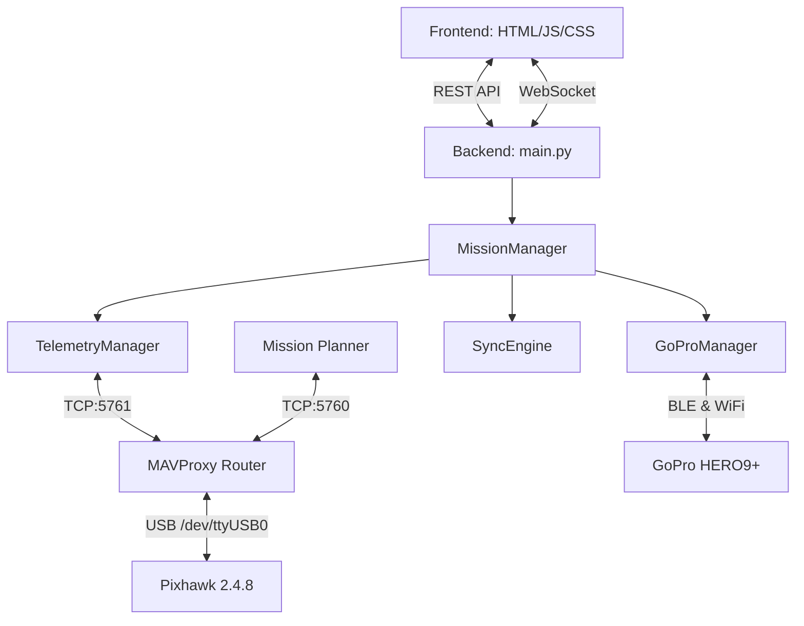

# Guía para Desarrolladores: Drone Mission Control Framework

Este documento está diseñado para futuros desarrolladores, investigadores o estudiantes de PRIA que deseen mantener, mejorar o extender el framework. Explica detalladamente la arquitectura subyacente, las decisiones de diseño y cómo interactúan los diferentes módulos.

---

## 0. Arquitectura vigente (dashboard en `web_dashboard.py`)

> Las secciones 1 a 5 describen el framework anterior (`main.py`), que el dashboard actual no usa.

| Archivo | Funcion |
|---|---|
| `web_dashboard.py` | FastAPI, pagina Control, hilo de telemetria (4 Hz), GoPro USB, procesamiento |
| `vincular_vuelo_dji.py` | Extraccion de fotogramas, interpolacion y metadatos |
| `sincronizar_relojes.py` | Deteccion de equipos, hora y desfase de la camara |
| `visor_vuelos.py` | Rutas `/api/vuelos` y `/vuelos`, visor con mapa, miniaturas y tags |
| `plan_vuelo.py` | Rutas `/api/plan`, validacion y protocolo de mision MAVLink |
| `static/pestanas.js`, `static/plan.html` | Pestañas y editor de plan; Leaflet 1.9.4 en `static/leaflet/` (BSD-2) |

Reglas: `PUERTO_LOCK` protege la apertura del puerto serie; durante una mision solo `bucle_telemetria` lee MAVLink;
las ordenes del plan exigen la cabecera `X-Hormigas`; la telemetria usa el reloj de la PC; los limites estan en `plan_vuelo.LIM`.

Datos por vuelo (`vuelos/NOMBRE_FECHA/`; `video/` y `fotos/` no se versionan por tamaño): `telemetria.csv`, `telemetria.tlog`, `mision.json`, `video/`, `fotos/`, `miniaturas/`.

Prueba sin hardware: `.venv/bin/python -u tests/simular_plan.py`

---

## 1. Arquitectura General del Sistema

El sistema sigue una arquitectura cliente-servidor basada en eventos, separando el hardware (cámara y telemetría) de la interfaz de usuario mediante una API REST y un canal WebSocket.



---

## 2. Descripción de los Módulos del Backend

### 2.1. `mission_manager.py` (El Orquestador)
Es el "cerebro" central del sistema. Implementa una máquina de estados finitos que gobierna el ciclo de vida completo de la misión:
* **Estados:** `IDLE` → `CONFIGURING` → `PRE_FLIGHT` → `IN_FLIGHT` → `LANDING` → `DOWNLOADING` → `SYNCING` → `COMPLETE`.
* **Función:** Coordina que la GoPro empiece a capturar solo cuando la telemetría está lista, y dispara la descarga de imágenes automáticamente cuando la telemetría reporta un aterrizaje (`LANDED` o `RTL`).
* **Mejoras Futuras:** Se podrían añadir nuevos estados (ej. `ERROR_RECOVERY`) o lógica de reintentos automáticos en caso de pérdida temporal de telemetría.

### 2.2. `telemetry_manager.py` y MAVProxy Router (Integración MAVLink)
Se encarga de la comunicación con el autopiloto (Pixhawk). Para evitar monopolizar el puerto serial y permitir el uso de Mission Planner en paralelo:
* **MAVProxy Router:** El sistema levanta un proceso en segundo plano de `mavproxy.py` que lee del puerto USB y lo expone en dos puertos TCP (`5760` para Mission Planner y `5761` para el Dashboard local).
* **Resolución de Conflictos (System ID):** El Dashboard local utiliza `source_system=254` al crear su conexión `pymavlink`. Mission Planner usa por defecto el 255. Esto es crítico para que ambos GCS (Ground Control Stations) coexistan sin que el drone o el router se confundan enrutando paquetes de respuesta, previniendo desconexiones.
* **Auto-Desconexión:** Al lanzar Mission Planner, el Dashboard local corta su propia conexión para dar el 100% del ancho de banda y prioridad de lectura a Mission Planner.
* **Logging:** Todos los mensajes recibidos se guardan en vivo en un archivo CSV dentro de la carpeta de la misión actual.

### 2.3. `gopro_manager.py` (Control Inalámbrico)
Gestiona la comunicación con la cámara utilizando la API oficial *Open GoPro*. El flujo es 100% inalámbrico:
1. **BLE + WiFi:** Utiliza la clase `WirelessGoPro` para escanear y conectar por Bluetooth de bajo consumo (BLE). A través de BLE, le da la orden a la GoPro de encender su propia red WiFi, y luego la computadora se conecta a esa red.
2. **Reconexión Rápida (WiFi Directo):** Tras aterrizar, el sistema utiliza `nmcli` (en Linux) para forzar a la computadora a reconectarse al SSID de la GoPro usando la contraseña guardada en `gopro_credentials.json`, permitiendo la descarga inmediata sin volver a pasar por el lento handshake de BLE.
3. **Mejoras Futuras:** En un entorno como la Jetson Nano en campo, asegurar que `nmcli` no entra en conflicto con otras redes (ej. si la base se conecta a internet vía 4G) es un área clave para mejorar la robustez.

### 2.4. `sync_engine.py` (Generación del Dataset)
Responsable del procesamiento de datos post-vuelo.
* **Extracción:** Usa la librería `Pillow` (PIL) para extraer los metadatos EXIF de las fotografías JPG (fecha original de captura).
* **Correlación:** Carga el CSV de la telemetría y, por cada foto, busca la fila de telemetría cuyo timestamp (tiempo del sistema u hora GPS) sea el más cercano.
* **Salida:** Genera el archivo `dataset_MXXX.csv` con columnas fusionadas: nombre de imagen, posición GPS (lat/lon/alt), velocidad, orientación y diferencia de tiempo en milisegundos entre la foto y el registro MAVLink.

---

## 3. Frontend y UI

El frontend es una Single Page Application (SPA) sin frameworks pesados (Vanilla JS), estructurada en un Wizard de 5 pasos para minimizar la fricción del usuario (operator-proof).

* `index.html`: Define la estructura, las tarjetas, y el contenedor del mapa de Leaflet.
* `style.css`: Proporciona un tema oscuro premium tipo "glassmorphism", diseñado para ser legible tanto en interiores como en exteriores brillantes.
* `app.js`: Contiene la lógica del negocio del cliente. Interacciona con la API REST (`/api/...`) para acciones transaccionales (crear misión, conectar, descargar) y mantiene un canal **WebSocket** (`ws://.../ws/telemetry`) abierto para recibir actualizaciones a ~2Hz con la latitud, longitud y métricas para actualizar el mapa en vivo y los indicadores (Gauges).

---

## 4. Estructura de Datos en Disco

Para mantener el orden y evitar colisiones de archivos entre diferentes vuelos en el mismo día, todo se guarda de forma estructurada en la carpeta raíz `misiones/`:

```
misiones/
├── M001/
│   ├── mission_config.json      # Metadatos (modo, intervalo, timestamps de inicio/fin)
│   ├── raw/                     # Todas las fotos y videos originales descargados
│   ├── telemetry/               # telemetry_log.csv (archivo crudo MAVLink)
│   └── dataset/                 # dataset_M001.csv (El producto final)
├── M002/
...
```
Esta carpeta `misiones/` está ignorada en `.gitignore` para no saturar el repositorio remoto.

---

## 5. Recomendaciones para Mejoras Futuras

1. **Soporte de Video y Extracción de Frames:**
   Actualmente el `sync_engine.py` está optimizado para fotografía (timelapse). Si se usa grabación de video continuo, el engine deberá modificarse para extraer frames del video utilizando OpenCV (`cv2.VideoCapture`) basado en marcas de tiempo relativas al inicio del video, o utilizar los metadatos GPMF (GoPro Metadata Format) embebidos en el MP4.

2. **Integración con ROS 2:**
   Si se decide montar el sistema en una Jetson Orin Nano, el `telemetry_manager.py` puede evolucionar de leer el radio SiK vía `pymavlink`, a suscribirse directamente a un tópico de `mavros` (ej. `/mavros/global_position/global`).

3. **Manejo de Errores WiFi en la Jetson:**
   Las computadoras SBC como Raspberry o Jetson suelen ser inestables manejando reconexiones WiFi (NetworkManager). Mejorar la lógica de reconexión y fallbacks (usando `wpa_supplicant` directamente o un dongle WiFi dedicado exclusivamente para la GoPro) aumentaría la robustez en campo.

4. **Visión Computacional en Tiempo Real:**
   Si se lograse hacer *streaming* en vivo (Live Preview) desde la GoPro a la Jetson usando OpenCV (RTSP/MJPEG), se podría correr un modelo YOLOv8 de detección de hormigas cortadoras directamente sobre el stream antes de aterrizar.
