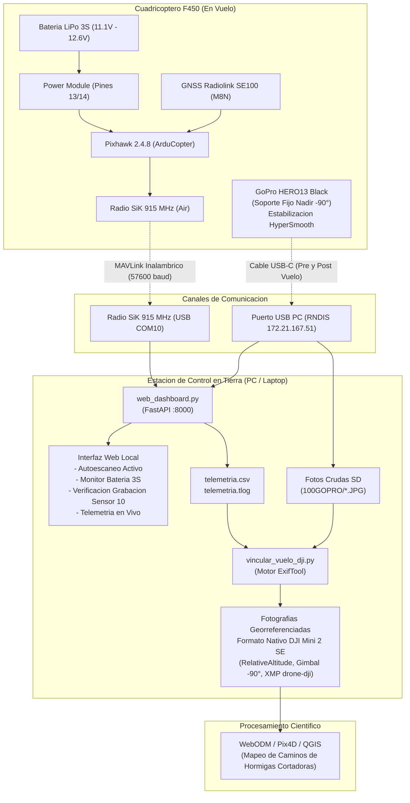
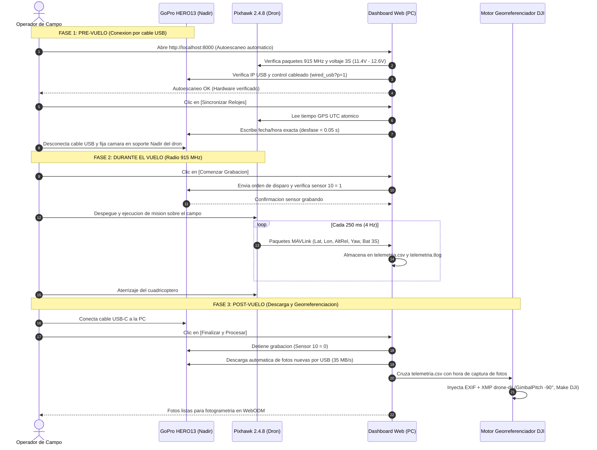

# Guia de Prompts e Instrucciones para IA: Diagramas e Ilustraciones del Sistema UAV
### Proyecto UTEC-PRIA | Deteccion de Hormigas Cortadoras

Este documento esta disenado especificamente para que cualquier modelo de Inteligencia Artificial (Claude, ChatGPT, Gemini, Midjourney, DALL-E, etc.) comprenda con maxima precision tecnica la arquitectura del sistema y pueda generar diagramas de arquitectura (Mermaid, PlantUML, Graphviz) o ilustraciones renderizadas de alta fidelidad.

---

## 1. Contexto Tecnico Obligatorio del Hardware y Software

Al solicitar diagramas o imagenes, la IA debe respetar estrictamente las siguientes especificaciones tecnicas:

| Componente | Especificacion Real | Detalle Critico para la IA |
| :--- | :--- | :--- |
| **Aeronave** | Cuadricoptero F450 (Flame Wheel 450 mm). | 4 brazos (rojo/blanco), helices de 9 a 10 pulgadas, sin tren de aterrizaje complejo. |
| **Controladora de Vuelo**| Pixhawk 2.4.8 (ArduPilot / ArduCopter). | Montada en el centro del chasis con flecha de orientacion hacia adelante. |
| **Bateria del Dron** | LiPo 3S (11.1 V nominal, 12.6 V carga maxima). | Conectada al modulo de potencia *Power Module* (lectura en Pin 13 y 14 de Pixhawk). |
| **Modulo GNSS / Brujula** | Radiolink SE100 (u-blox M8N). | Elevado en un mastil vertical negro sobre el dron para evitar interferencias magneticas. |
| **Radio de Telemetria Aire** | SiK / 3DR Radio 915 MHz (500 mW). | Conectada al puerto `TELEM1` de Pixhawk, con pequena antena de varilla vertical orientada hacia abajo. |
| **Radio de Telemetria Tierra**| SiK / 3DR Radio 915 MHz con conector USB. | Dongle USB conectado a la laptop de campo en `COM10` (57600 baudios). |
| **Camara** | GoPro HERO13 Black. | **Montada en el vientre del dron apuntando verticalmente hacia el suelo (Nadir, angulo de -90°).** |
| **Estabilizacion de Camara** | **SIN GIMBAL FISICO / SOPORTE FIJO.** | **NO ilustrar cardan ni motores de gimbal.** La camara va en soporte rigido de impresion 3D. La estabilizacion de horizonte la realiza electronicamente la propia camara mediante HyperSmooth. |
| **Formato de Metadatos** | Formato nativo **DJI Mini 2 SE**. | Las fotos finales simulan provenir de un DJI Mini 2 SE (`GimbalPitchDegree = -90.0`, `GimbalRollDegree = 0.0`) para compatibilidad directa con WebODM y SIG. |

---

## 2. Prompts para Diagramas de Arquitectura (Mermaid / Markdown)

Copie y pegue estos bloques en cualquier conversacion con una IA para generar diagramas conceptuales interactivos.

### Diagrama A: Arquitectura Completa del Sistema
```text
Genera un diagrama Mermaid (flowchart TD) que represente la arquitectura tecnica del proyecto de telemetria UAV UTEC-PRIA respetando estrictamente:
1. El dron F450 tiene: Bateria LiPo 3S -> Power Module -> Pixhawk 2.4.8 -> GNSS M8N y Radio Aire 915 MHz.
2. Camara GoPro HERO13 montada fija en el vientre mirando a -90 grados (Nadir) con estabilizacion HyperSmooth propia (sin gimbal fisico).
3. Enlace inalambrico de telemetria MAVLink a 915 MHz hacia la Radio Tierra USB conectada a la PC (COM10, 57600 baudios).
4. Enlace USB por cable para la sincronizacion de relojes previa (<0.05s) y descarga de archivos post-vuelo.
5. Servidor local web_dashboard.py (FastAPI, localhost:8000) que alimenta el panel web.
6. Motor vincular_vuelo_dji.py que toma telemetria.csv + fotos crudas e inyecta metadatos DJI Mini 2 SE (XMP drone-dji) para WebODM/QGIS.
```

### Codigo Mermaid Renderizable (Resultado Esperado):


---

### Diagrama B: Secuencia Temporal del Flujo Operativo en Campo


---

## 3. Prompts para Generadores de Imagenes (Midjourney / DALL-E / Imagen 3)

### Prompt 1: Render Tecnico Isometrico del Dron F450
```text
Industrial design technical isometric render of an F450 quadcopter drone for agricultural aerial mapping. The drone has four arms (two red in front, two white in back) with 10-inch black propellers. Mounted on the top center plate is a black Pixhawk flight controller with clean wiring, and a tall thin black mast holding a round GPS antenna puck. Mounted firmly directly underneath the bottom plate, facing straight down perpendicularly towards the ground (nadir 90-degree angle), is a compact GoPro HERO13 Black action camera secured in a rigid matte-black 3D-printed fixed mount with NO physical gimbal or gimbal motors. A 3S LiPo battery is mounted neatly with a velcro strap. A small 915MHz telemetry antenna points downwards. Clean studio lighting, technical exploded view aesthetic, dark technical background, 8k resolution, photorealistic CAD octane render.
```

### Prompt 2: Escena Operativa en Campo Real (Uruguay)
```text
A professional aerial survey quadcopter drone (F450 frame with red and white arms) flying at 25 meters altitude above an open agricultural grassland field in Uruguay with visible natural trails on the green grass. Mounted directly underneath the belly of the drone is a GoPro camera pointed vertically straight down in a fixed nadir position without any mechanical gimbal. In the foreground on the ground, an agronomist researcher operates a rugged laptop placed on a folding field table; on the laptop screen, a sleek modern web dashboard displays drone telemetry data (height, battery 11.8V, GPS coordinates). Connected to the laptop USB port is a small black 915MHz telemetry radio dongle with a small antenna. Sunny afternoon, cinematic lighting, ultra-realistic documentary photography style, high detail.
```

### Prompt 3: Esquema Infografico de Comunicacion y Datos
```text
A clean technical infographic diagram on a light blueprint background showing the workflow of a scientific UAV system: on the left, a quadcopter drone with a downward-facing nadir camera; in the middle, two communication paths (a wireless 915MHz radio telemetry link and a USB cable link); on the right, a laptop running a telemetry mission control dashboard generating a CSV file and outputting drone geotagged photos with DJI Mini 2 SE metadata tags for photogrammetry. High resolution, clear typography, professional engineering diagram.
```

---

## 4. Reglas Criticas de Verificacion para Otras IAs

1. **Nunca agregar un gimbal motorizado de 3 ejes:** El dron F450 no tiene espacio ni carga util para un gimbal; la GoPro HERO13 utiliza su estabilizacion interna HyperSmooth. En los metadatos DJI generados, `GimbalPitchDegree` es fijo en `-90.0` y `GimbalRollDegree` es `0.0`.
2. **Frecuencia de telemetria:** La radio opera en **915 MHz** (estandar SiK para America Latina / FCC), **no en 433 MHz ni 2.4 GHz**.
3. **Bateria:** El dron utiliza bateria **LiPo 3S** (rango operativo de 10.5 V a 12.6 V), no 4S ni 6S.
4. **Formato de salida:** El objetivo final es producir fotografias con etiquetas identicas a las de un **DJI Mini 2 SE** para que el software fotogrametrico (WebODM) detecte la camara automaticamente y cree ortomosaicos a escala milimetrica sin requerir configuracion manual.
